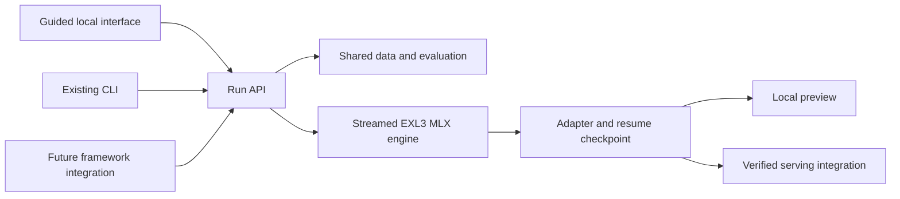

# Proposed simple fine-tuning flow

Status: design following the [usefulness review](reports/usability-review.md),
2026-10-12. The guided interface and integrations below are **not implemented**.
The current runnable interface remains the expert-oriented [recipe](RECIPE.md).

A person should choose a supported model, supply examples of the desired behavior,
and see whether the result improved. They should not have to understand LoRA
rank, optimizer state, adapter tensor names, or decoder chunks to complete a run.

## Five steps

| Step | What the person sees | What the tool handles |
|---|---|---|
| 1. Choose model | Local supported models and a clear compatibility result | Validate exact architecture, packed layout, required banks, disk and memory. Explain unsupported inputs before loading. |
| 2. Add examples | Drop CSV/JSONL; map “question” and “desired answer”; preview a few examples | Convert supported schemas, preserve source IDs, show learned-answer masks, token lengths, duplicate counts and split membership. Reject unsupported tool/image content clearly. |
| 3. Check this run | Example count, supported lengths, memory setting and measured time estimate | Choose a versioned preset, validate a single coherent configuration, run a bounded pilot, and create immutable train/dev/test identities. Show any failed checks with a specific remedy. |
| 4. Fine-tune | Progress, time remaining range, validation trend, Stop and Resume | Stream weights, checkpoint safely, preserve best and latest adapters, and retain the full resume contract. Keep technical settings under Advanced. |
| 5. Compare and use | Same prompts side by side, held-out task score, regression cases and “Try my model” | Evaluate base/adapter identically, reload in a fresh process, record EOS/truncation, select by validation, and evaluate the final test once. Offer only verified runtime destinations. |

The main result must distinguish **training completed**, **improvement measured**,
**no improvement**, and **evaluation incomplete**. Lower training loss must not
turn the result green by itself. An unsupported destination should be labeled
before training, not discovered at export time.

For tiny datasets, offer a clearly labeled fitting demonstration with no held-out
quality claim. For real work, preserve group/source splits and ask for enough
independent examples to evaluate the task. Fine-tuning a behavior and loading a
library of factual documents are different jobs; the example-import screen should
make the intended objective explicit.

## Reuse one engine

This is a proposed architecture. Start with a small `inspect / prepare / pilot /
train / resume / evaluate / generate` service boundary over the existing code.
Use structured progress/error events and a durable run manifest. A local UI can
run the engine in a separate process to retain memory isolation. It must not
create a second trainer or alter masking, math, checkpoint or resume semantics.

Continue using MLX-LM's tested data/loss/LoRA pieces. A future MLX-Tune-style API
can adapt calls to this run API, explicitly identifying the streamed EXL3 backend.
Do not advertise arbitrary TRL/Unsloth scripts as interchangeable. Unsupported
options should fail clearly instead of silently becoming defaults.

Keep the base quantized and immutable. Prefer applying adapters at inference
rather than dequantizing or merging hundreds of gigabytes. A serving adapter must
map every trained attention/expert tensor and preserve scale, orientation, base
identity and template. Validate layer outputs and final logits before claiming
compatibility; filename conversion is insufficient.

## Defaults and operations

- Derive one sequence limit from the dataset and a measured preset. Do not inherit
  today's contradictory prepare=128/train=16 defaults. Never silently truncate a
  desired answer or exceed the architecture's current 512-token limit.
- Version presets by model/layout/device evidence. The successful toy run is not
  enough to establish a universal learning rate or small-Mac memory setting.
- Use a pilot with representative example lengths to estimate work. Label estimate
  uncertainty; enforce a run-time budget at safe update boundaries.
- Pin the best validation checkpoint independently of latest-checkpoint retention.
  Keep final test results separate from checkpoint selection.
- Resume selects the last verified complete checkpoint and restores its settings.
  A fresh-optimizer warm start is a separately named action.
- A stop/memory/disk interruption should show the retained checkpoint, what was
  completed, and one concrete recovery action. Do not silently increase limits.
- Projects store resolved paths, input provenance, group splits, effective settings,
  a readable report, and the command/API invocation needed to reproduce the run.

## Acceptance checks before calling it simple

1. A fresh user reaches the supported-model screen without editing source or
   manually choosing a Python environment. Unsupported models fail before large
   allocations and before a lengthy repack/download.
2. CSV, prompt/completion, messages, and explicitly mapped Alpaca/ShareGPT fixtures
   either import correctly or identify the exact unsupported rows. Source metadata
   survives splitting. A rendered preview matches actual tokenization/loss masks.
3. A 41-token example prepares and trains with the same effective limit. An example
   beyond 512 tokens gets a clear explanation, not silent truncation. A two-row
   demo is never represented as three independent evaluation splits.
4. The system predicts compatibility/resource limits before training and records
   actual pilot time/memory. Benchmark at least one realistic supported task and
   more than one practical example length before publishing speed claims.
5. Interrupted training resumes through the interface and matches uninterrupted
   adapter/optimizer state under the existing exact-continuation contract.
6. The best validation checkpoint survives retention. A deliberately harmful
   adapter and a constant-answer adapter cannot be labeled improvements by the
   report just because their training loss decreased.
7. The chosen adapter loads in a fresh preview process. One intended serving
   destination loads it with validated numerical mapping; all unimplemented
   destinations remain explicitly unavailable.
8. Three unfamiliar users can complete the supported journey and recover an
   interruption without engineering assistance. Record where they fail or ask
   for help, then revise the flow. Do not substitute unit tests for this study.

Independent model parity and representative held-out quality remain prerequisites
for a broad useful-training claim; see [quality gates](QUALITY.md). A simple
interface should make these distinctions understandable, not conceal them.

## Git-history import for the Metal optimization use case

The user's primary dataset is successful inference-engine optimizations. Add a
“From Git history” importer alongside file import. It should inventory candidate
changes, reconstruct before/after code, locate real benchmark receipts, preserve
commit rationale and hardware context, group related changes before splitting,
and show whether complete examples fit. The user reviews “verified improvement,”
“measurement missing,” and “reverted or regressed” cases separately. A successful
commit message is not itself a benchmark receipt.

The result screen for this task should report compiled, correct, measurably faster
patches on unseen tasks, with end-to-end inference and memory regressions visible.
Our sampled corpus mostly exceeds the current context limit, so this flow must
show the longer-context requirement before offering a full run. See the
[Metal task assessment](reports/metal-training-assessment.md).
