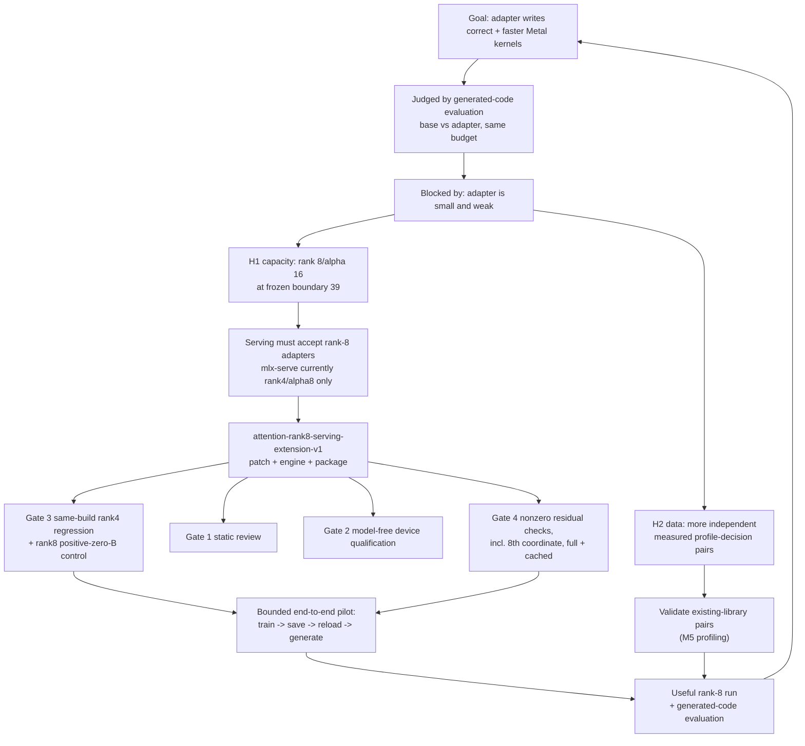

# Plan: from the Metal-kernel goal to today's work

Date: 2026-10-16. Author: agent session on the Studio. Status: active plan, supersedes nothing;
it *reads down* the existing plans and adds the missing traceability layer.

Read with: [handoff](apple-metal-optimization-handoff-2026-10-15.md),
[active experiment plan](apple-cache-aware-experiment-plan.md),
[evaluation framework](apple-generated-kernel-evaluation.md).

## Why this document exists

The recent work sits deep in serving/qualification machinery and it is fair to ask how that
relates to "train an adapter that writes better Metal kernels". This document answers that in
one chain, marks what is on the critical path and what is not, and states the minimum work
required to get back to judging generated kernels.

## 1. The goal, and the only measure that counts

> "Build reusable Apple-silicon EXL3 fine-tuning tools and an adapter that generates
> **correct, faster Metal kernels and makes useful optimization decisions from measured
> profiles**." — handoff, *User goal and immediate priority*

> "The goal is more correct, measurably faster generated kernels from the fine-tuned model
> than from the same base under the same practical generation allowance. Lower loss, valid
> patches, and completed training runs are intermediate evidence only." — active plan

The goal measure is **usable faster kernels**: valid edit → replay → compile → all numerical
cases pass → repeatable speedup over the *supplied* baseline on the declared target workload
(≥5% on the target workload is the practical first-pass bar; below that is inconclusive).
Counts, missing coverage and every regression are reported. Nothing else is a win.

## 2. The chain, top to bottom

Read the middle band carefully: **the serving extension is not the experiment.** It is the
prerequisite that makes the capacity experiment *applicable at all*. The handoff is explicit:
"Do not spend hours training an adapter that the serving path cannot apply." Gates 1–4 exist so
that a rank-8 adapter cannot silently produce different numbers from the rank-4 engine.

## 3. Where the evidence actually stands

Adapter lineage (handoff, *Adapter lineage*): original458 (229 items, 2 epochs) → full238
(696 updates). Trained tensors: `wq_a` and `wo_b` LoRA of block 39 only, rank 4 / alpha 8 =
**78,848 trainable parameters**. That is the capacity being questioned by H1.

Latest completed evaluation (full238, four deterministic generations, all correct):

| Task | original458 | full238 | Reading |
|---|---:|---:|---|
| Row RMS statistic | 10.908× | 12.310× | positive signal; lower median latency 9/12 workloads |
| Strided transpose | 2.264× | 2.260× | comparable |
| Rotation, profile supplied | 2.297× | 2.310× | comparable |
| Rotation, profile omitted | 2.343× | 2.324× | comparable; no profile-guided reasoning shown |

Ratios are of summed measured baseline/candidate durations across 12 workloads, i.e. speedup
over the supplied kernel, not adapter-vs-adapter. Decision on record: keep full238 as a
promising RMS challenger, original458 as reference, no broad replacement winner.

Rank-8 native serving status: the linked artifact `80ea4e31…be7d17c` passed static review and
the **device qualification is finished** — 26/26 model-free cases, bit-exact against the seam
including the intermediate `astype(z*2, dt)` rounding, independently recomputed
(`attention-rank8-serving-extension-v1/device-qualification-v1/RESULT.md`, `run-v3`,
`cases-v2.json` sha256 `3990621e…f28eda`). The package copy is built
(`runtime-package-attention-rank8-v1`, `package-receipt.json` present).

## 4. What the remaining work is, precisely

The patch README names the pre-deployment list. Mapping it to artifacts:

| Gate | Artifact | State |
|---|---|---|
| Independent source review | `attention-rank8-serving-extension-v1` | **done** (static + `build-v1/independent/artifact-review-v1.json`) |
| Fresh reviewed native link/artifact/package | `runtime-package-attention-rank8-v1` | **built**, `independent-static-v1/review-v1.json` present |
| Same-build rank4 regression | `rank8-widened-identity-v1` | **plan written, requests written, no independent review → cannot run** |
| Rank8 positive-zero-B control | `rank8-zero-b-native-control-v3` | **plan written, requests written, no independent review → cannot run** |
| Rank8 nonzero residual + 8th coordinate | same two lanes | blocked behind the above |
| Memory/lease guards | both lanes | source-derived preclaim implemented |

So the rank-8 route is **two plan reviews and two short runs** away from evaluable, not a
research program. Both lanes are `V/exact-generation-qualification-v1/<lane>`; both have
`independent/` empty; both fail `operation.py --verify` at `independent review missing`.

### Defect found this session (must fix before the zero-B lane is run)

`rank8-zero-b-native-control-v3` carries a verdict that compares the rank-8 engine against a
**different engine's** published row, so it fails for a reason that has nothing to do with
rank 8. Evidence — sha256 of the position-33 absent row per engine:

| Lane | Engine binary | Position-33 absent row |
|---|---|---|
| `short-serving-operation458-f32-smoke-process40-v1` | `800b8a3f` = **accepted 800b** | `266166f5…` |
| `rank8-zero-b-native-control-v2` | `80ea4e31` = rank-8 | `266166f5…` |
| `short-serving-operation150-report80-v3` | `ebc54335` = report engine | `ef651a4e…` |

The rank-8 engine reproduces the **accepted 800b** engine bitwise. The lane's witness points at
`report80-v3/zero-b-33.json` (`ef651a4e`), a diagnostic build on a different source tree
(`cached-inference-v4/host-prototype` + `exact_generation_profile_repair`), so
`absent_reproduces_published_rank4_logits` is false by construction and the lane reports
`completed_with_failed_verdicts`.

That contradicts the route's own authoritative spec, `qualification-plan-v1.json` phase_b:

> "Exact initial raw-logit bits and token equality between **same-build** absent and zero-B …
> **Compare rank4 existing one-prefix result descriptively** … do not treat it as a broad
> parity certificate." — with `non_goals: ["perfect cross-mode bitwise parity", …]`

and the docstring's own claim ("the widening introduced no arithmetic change") is in fact
**confirmed** against the engine the patch was applied to (`source-delta.json` base =
`full-prompt-projection-f32-candidate-v1/prototype`). Two code defects follow: the cross-engine
comparison is a blocking verdict, and the intended `rank8_engine_baseline_shift` status is
unreachable dead code (`all(verdicts.values())` shadows it).

Fix: make the witness the artifact from the engine the patch was applied to, keep the
same-build verdicts as the acceptance, and record the cross-engine comparison descriptively
(both rows, with engine identity) instead of gating on it. Do not choose the expected value
after observing the run: select the witness by the *pre-widening engine identity* rule, and
say so in the plan text so a reviewer can audit it.

Note also: `rank8-widened-identity-v1/plan.json` already records its prerequisite as
"Recorded, **not enforced** at launch", so the zero-B lane's status does not gate the widened
lane. The two lanes are independent; fix the defect for correctness of the record, not to
unblock.

## 5. Immediate plan

Ordered, with the host each step belongs to. One admitted GPU job per host.

**Track A — make H1 testable (Studio, the critical path)**

1. Fix the witness defect in `rank8-zero-b-native-control-v3` (plan text + `PUBLISHED`
   constant + `verify_plan` pin + docstring claim). Record both published rows descriptively.
2. Regenerate `plan.json`, re-run `--verify`, then obtain an **independent** review artifact at
   `independent/review-v1.json` (schema `short-serving150-operation-independent-review-v1`,
   status `approved_scoped_operation_source_no_launch`, `reviewer != "author"`, all verdicts
   true, `inputs_sha256` + `plan_sha256` binding the exact operation).
3. Run the zero-B lane: two serial owned-lease cases on the frozen 33-token prompt, context
   256, 1 new token, greedy. Acceptance = same-build absent vs positive-zero-B raw-logit bits.
4. Same review-then-run for `rank8-widened-identity-v1` (rank-4 parent vs rank-8 widened,
   identity on the eighth coordinate).
5. Bounded end-to-end pilot on **M5**: train rank-8/alpha-16 → save → exact reload → generate
   one real condition. Record the chosen parent, fresh optimizer, actual cache hits, cold cost
   and memory. A directly expanded rank-4 adapter is not a fresh random rank-8 baseline.
6. Only then a useful rank-8 run, judged by generated-code evaluation (section 1 measure).

**Track B — H2 data content (M5 profiling, parallel, no GPU conflict with Studio)**

7. Validate additional feasible independent optimization pairs already collected — not fetched.
   Each example needs baseline code, real workload/precision/dispatch context, baseline
   measurements, a concise grounded decision, complete correct code, and real feedback where
   used. `correctness-pilot-inventory-v1` plus the reviewed measured drafts are the inventory.
   Report real lineage counts and gaps; do not pad a quota. row48 draft-v2 is the precedent,
   draft-v1 is not.

Track A step 5 and Track B both want the M5; sequence them, do not overlap.

## 6. Not on the critical path — do not start these

- Re-running the rank-8 device qualification. It is finished; use a fresh run directory only if
  a concrete new change appears.
- Rebuilding the engine. The accepted 800b rank-4 engine
  (`runtime-package-full-prompt-f32-v1/runtime/host/bin/mlx-serve`) and the rank-8 package
  already exist; extending this route suffices.
- A full-41 zero-B score, a new inference engine, whole-trainer parity, or "perfect controls"
  as prerequisites — the handoff forbids these as defaults.
- Layer 38 or broader final-block coverage. Moves the frozen boundary, needs new cached states,
  earlier backward, serving support and a measured cold-cost pilot. Separate capacity path.
- Another learning-rate sweep, another epoch on identical rows, or a repeat of the same three
  profile records.
- Source collection, Qwen, recurring automation notices. All stay paused/parked.
- Rerunning completed generations or timings (RMS, transpose, rotation). Reuse by exact
  identity; new adapter work needs a fresh condition/output directory.

## 7. Definition of done for the rank-8 route

The route is **evaluable** when: both lanes have independent plan reviews, both have run and
published results, the zero-B lane's record shows the same-build acceptance verdicts with the
cross-engine comparison recorded descriptively, and a rank-8 adapter has been served end to end
on a real condition. Then H1 stops being an infrastructure project and becomes a training
experiment judged by section 1.

## 8. Stop / timing decisions

- If the two reviews plus two runs have not produced an evaluable route, stop and report; do not
  add gates to the gate.
- The bounded end-to-end pilot is the go/no-go for the useful rank-8 run. If serving applies a
  rank-8 adapter but generation quality is unchanged, H1 is answered negatively — record it and
  move to H2, which needs no new serving work.
- Keep full238 and original458 both. No adapter is replaced on the strength of a single family.

## 9. Open risks

- Cache eligibility for rank 8 under unchanged runtime-v5 is *promising but unverified*
  (handoff). Measure actual bindings and hits in step 5; do not assume reuse.
- A rank-8 adapter trained by expansion from rank-4 needs an explicitly implemented and tested
  orientation/padding/scaling mapping. A valid schema alone does not establish equivalent
  predictions, and zero-B components preserve the intended initial function only if the
  arithmetic contract is validated — which is exactly what gates 3 and 4 test.
- Capacity is a plausible bottleneck, not an established explanation for every quality result.
  Rank 8 doubles 78,848 parameters and is still a small intervention.
